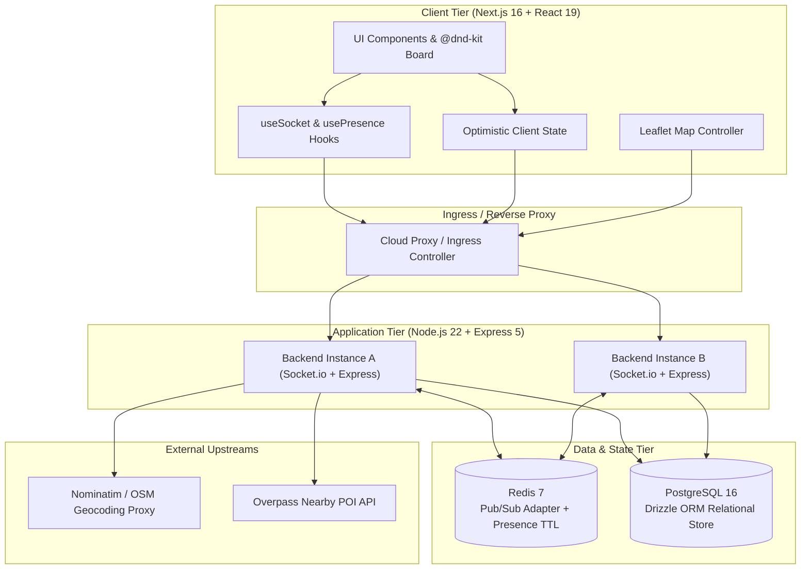
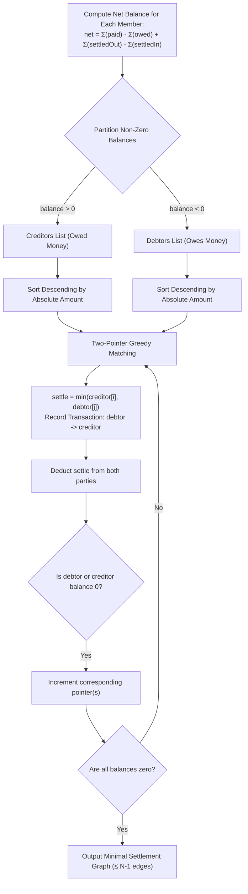

# Architecture & Technical Design

This document provides a low-level architectural deep-dive into **TripSync**, explaining design choices, data pipelines, real-time coordination mechanisms, and system trade-offs.

---

## 1. High-Level Architecture Topology

TripSync adopts a multi-tier, modular client-server architecture designed for high-concurrency real-time collaboration.



---

## 2. Real-Time Synchronization Engine

### Redis Pub/Sub Cluster Adapter
When multiple backend instances run behind a reverse proxy (e.g. Fly.io, Kubernetes, or AWS ECS), a WebSocket connection established on **Instance A** cannot directly emit packets to clients connected to **Instance B**.

TripSync integrates `@socket.io/redis-adapter` backed by two distinct `ioredis` instances:
1. **`pubClient`**: Broadcasts outgoing room events to the Redis cluster channel.
2. **`subClient`**: Subscribes to cluster channels and invokes the local socket engine when a remote event arrives.

```
Node Instance A                                             Node Instance B
┌───────────────────────┐                                   ┌───────────────────────┐
│ User 1 socket.emit    │                                   │ User 2 socket.on      │
│   'block:move'        │                                   │   'block:moved'       │
│           │           │                                   │           ▲           │
│           ▼           │                                   │           │           │
│   Redis Adapter (Pub) ├──────────┐             ┌──────────┤   Redis Adapter (Sub) │
└───────────────────────┘          │             │          └───────────────────────┘
                                   ▼             │
                        ┌────────────────────────┴─────┐
                        │        Redis 7 Pub/Sub       │
                        │      Channel: socket.io#     │
                        └──────────────────────────────┘
```

### Ephemeral Presence & Heartbeat Architecture
Online user presence is transient by nature. Persisting presence records to PostgreSQL creates disk I/O thrashing and connection lock contention. TripSync uses **Redis Hashes and String Keys with auto-expiring TTLs**:
- **Join**: Upon entering a trip room (`join:trip`), `apps/server/src/services/presence.service.ts` writes a JSON payload to `presence:<tripId>:<userId>` with an explicit **30-second TTL** (`EX 30`) and adds the `userId` to a Redis Set (`presence:<tripId>:members`).
- **Heartbeat**: Every 15 seconds, active clients emit a lightweight heartbeat pulse that refreshes the Redis key TTL back to 30 seconds.
- **Leave / Disconnect**: On explicit departure or unexpected socket disconnect, `presence:<tripId>:<userId>` is removed, the set member is deleted via `SREM`, and a `presence:leave` broadcast is dispatched.
- **Self-Healing Cleanup**: If a browser crashes or network drops without a socket disconnect payload, Redis automatically expires the key. The next invocation of `getOnlineMembers()` detects orphaned IDs in the set and cleans them up lazily.

---

## 3. Algorithmic Modules

### 3.1 Fractional Indexing for O(1) Reordering
Traditional list reordering requires updating dense integer positions ($1, 2, 3, \dots, N$). Moving an item from position $100$ to position $2$ requires updating $98$ distinct rows in PostgreSQL ($O(N)$ write amplification).

TripSync implements fractional indexing via floating-point midpoints (`apps/server/src/services/itinerary.service.ts`):
```ts
export function calculatePosition(before: number | null, after: number | null): number {
  if (before === null && after === null) return 1.0;
  if (before === null) return after! / 2;
  if (after === null) return before + 1.0;
  return (before + after) / 2;
}
```

- Inserting at the beginning: `position = after / 2`
- Appending at the end: `position = before + 1.0`
- Inserting between two blocks: `position = (before + after) / 2`

**Mitigating Precision Loss**:
Repeatedly inserting between identical adjacent slots narrows the difference towards IEEE 754 float limits ($~10^{-7}$). To resolve this, TripSync provides an explicit rebalancing procedure (`reorderBlocks`) that resets the positions of a day's blocks to clean sequential integers (`1.0, 2.0, 3.0`) whenever an anomaly or edge collision is detected.

---

### 3.2 Greedy Graph Debt Settlement Algorithm
In a shared trip, members incur mutual debts across various expenses (e.g., Alice paid for dinner, Bob paid for hotel, Charlie paid for transit). This forms a directed cyclic graph with up to $O(N^2)$ debt edges.

TripSync reduces group settlements to at most **$N - 1$ discrete transactions** using a greedy bipartite matching algorithm (`apps/server/src/services/expense.service.ts`):



#### Mathematical Properties:
1. **Conservation of Value**: In any closed expense ledger, the sum of all credits strictly equals the sum of all debits: $\sum \text{credits} = \sum \text{debits}$.
2. **Termination**: Every greedy iteration matches $\min(\text{credit}_i, \text{debit}_j)$, which guarantees that at least one creditor or one debtor reaches a net balance of exactly $0$ and exits the pool. Therefore, for $K$ members with non-zero balances, the algorithm terminates in at most $K - 1 \le N - 1$ steps.

---

### 3.3 Integer Minor-Unit Accounting & Remainder Absorption
JavaScript standard numbers are IEEE 754 double-precision floats. Operations such as `0.1 + 0.2` yield `0.30000000000000004`. Over long trip ledgers, floating-point rounding errors create unresolvable fractional currency drift.

TripSync strictly enforces **integer minor units** (`amountMinor`, `owedMinor`, `paidMinor`) across database columns, Zod schemas, and internal calculations (e.g. INR is calculated in *paise*, USD in *cents*):
- **Equal Splits**: Base amount is $\lfloor \text{total} / M \rfloor$. The remainder $R = \text{total} \pmod M$ is distributed $1$ minor unit each to the first $R$ participants.
- **Percentage Splits**: Each member's share is $\text{round}((\text{total} \times P_i) / 100)$. To prevent loss due to discrete rounding, all accumulated residual variances are absorbed into the final participant:
  $$\text{share}_M = \text{total} - \sum_{i=1}^{M-1} \text{share}_i$$
This guarantees the fundamental invariant:
$$\sum_{i=1}^M \text{owedMinor}_i \equiv \text{amountMinor}$$

---

## 4. Architectural Trade-offs Matrix

| Design Choice | Evaluated Alternative | Rationale | Trade-off / Mitigation |
| :--- | :--- | :--- | :--- |
| **Drizzle ORM** | Prisma | Zero query engine binaries, negligible cold-start latency, lightweight SQL-like syntax. | No automated nested relation cascades on inserts; handled explicitly in service methods. |
| **Float Fractional Indexing** | String-based Lexorank | Clean numeric representation in PostgreSQL, straightforward comparisons, simple arithmetic. | Potential float underflow under extreme repeated midpoint inserts; mitigated by `reorderBlocks()`. |
| **Hybrid REST + WebSockets** | Pure WebSockets / GraphQL | REST handles cacheable, heavy, or paginated HTTP reads and standard form submissions; WebSockets handle low-latency collaboration. | Dual client transport handling; coordinated via matching optimistic IDs. |
| **Stateless JWT Auth** | Stateful Server Sessions | No session store lookups on high-frequency WebSocket packet validations. | Inability to immediately revoke tokens prior to the 7-day expiration; mitigated by token rotation upon role changes. |
