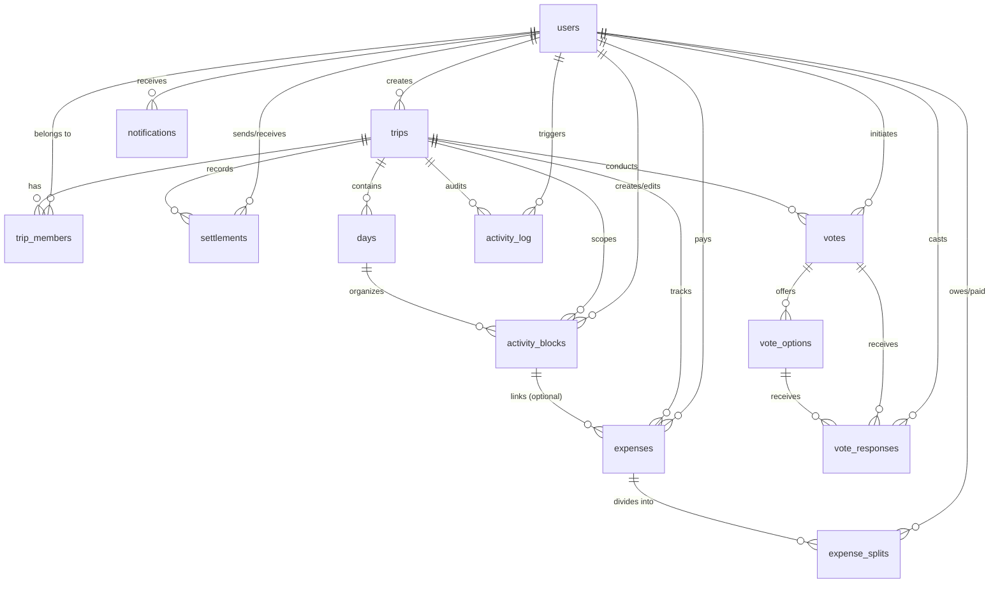

# Database & Schema Reference

TripSync stores its persistent relational data in **PostgreSQL 16**, defined and queried through **Drizzle ORM** (`apps/server/src/db/schema.ts`).

---

## 1. Entity-Relationship Diagram



---

## 2. Table Schemas & Definitions

### 2.1 `users`
Core user identity credentials and profile preferences.
```sql
CREATE TABLE users (
    id UUID PRIMARY KEY DEFAULT gen_random_uuid(),
    email TEXT NOT NULL UNIQUE,
    name TEXT NOT NULL,
    avatar_id INTEGER,
    password_hash TEXT,
    created_at TIMESTAMP NOT NULL DEFAULT NOW()
);
```
- `avatar_id`: Small integer referencing pre-rendered SVG avatar identifiers from `@tripsync/shared` (avoids storing arbitrary images/URLs for default avatars).
- `password_hash`: Nullable to support future OAuth single-sign-on flows.

---

### 2.2 `trips`
Top-level trip container.
```sql
CREATE TABLE trips (
    id UUID PRIMARY KEY DEFAULT gen_random_uuid(),
    title TEXT NOT NULL,
    destination TEXT NOT NULL,
    destination_lat REAL,
    destination_lng REAL,
    start_date DATE NOT NULL,
    end_date DATE NOT NULL,
    created_by UUID NOT NULL REFERENCES users(id),
    invite_code TEXT NOT NULL UNIQUE,
    cover_image_url TEXT,
    timezone TEXT,
    created_at TIMESTAMP NOT NULL DEFAULT NOW()
);
```

---

### 2.3 `trip_members`
Association table mapping users to trips with assigned RBAC roles.
```sql
CREATE TABLE trip_members (
    id UUID PRIMARY KEY DEFAULT gen_random_uuid(),
    trip_id UUID NOT NULL REFERENCES trips(id) ON DELETE CASCADE,
    user_id UUID NOT NULL REFERENCES users(id),
    role TEXT NOT NULL CHECK (role IN ('owner', 'editor', 'viewer')),
    joined_at TIMESTAMP NOT NULL DEFAULT NOW()
);
```

---

### 2.4 `days`
Represents an individual calendar day within a trip's date range.
```sql
CREATE TABLE days (
    id UUID PRIMARY KEY DEFAULT gen_random_uuid(),
    trip_id UUID NOT NULL REFERENCES trips(id) ON DELETE CASCADE,
    date DATE NOT NULL,
    day_number INTEGER NOT NULL
);
```

---

### 2.5 `activity_blocks`
Itinerary items assigned to a day and sorted by fractional position.
```sql
CREATE TABLE activity_blocks (
    id UUID PRIMARY KEY DEFAULT gen_random_uuid(),
    day_id UUID NOT NULL REFERENCES days(id) ON DELETE CASCADE,
    trip_id UUID NOT NULL REFERENCES trips(id) ON DELETE CASCADE,
    title TEXT NOT NULL,
    description TEXT,
    category TEXT NOT NULL CHECK (category IN ('food', 'travel', 'stay', 'activity')),
    start_time TEXT,
    end_time TEXT,
    location_name TEXT,
    latitude REAL,
    longitude REAL,
    estimated_cost REAL,
    currency TEXT DEFAULT 'INR',
    position REAL NOT NULL,
    created_by UUID NOT NULL REFERENCES users(id),
    last_edited_by UUID REFERENCES users(id),
    created_at TIMESTAMP NOT NULL DEFAULT NOW(),
    updated_at TIMESTAMP NOT NULL DEFAULT NOW()
);

-- Primary index for loading the board
CREATE INDEX activity_blocks_trip_day_position_idx
ON activity_blocks (trip_id, day_id, position);
```

---

### 2.6 `expenses`
Header records for shared trip financial ledger items.
```sql
CREATE TABLE expenses (
    id UUID PRIMARY KEY DEFAULT gen_random_uuid(),
    trip_id UUID NOT NULL REFERENCES trips(id) ON DELETE CASCADE,
    activity_block_id UUID REFERENCES activity_blocks(id) ON DELETE SET NULL,
    title TEXT NOT NULL,
    amount_minor INTEGER NOT NULL,
    currency TEXT NOT NULL DEFAULT 'INR',
    paid_by UUID NOT NULL REFERENCES users(id),
    split_type TEXT NOT NULL CHECK (split_type IN ('equal', 'custom', 'percentage')),
    deleted_at TIMESTAMP,
    created_at TIMESTAMP NOT NULL DEFAULT NOW()
);

CREATE INDEX expenses_trip_id_idx ON expenses (trip_id);
```
- `amount_minor`: Monetary total stored as integer minor units (e.g. 10000 = ₹100.00).
- `deleted_at`: Soft-delete timestamp. Retained for audit trails, but excluded from net balance summaries.

---

### 2.7 `expense_splits`
Individual debtor/creditor shares per expense item.
```sql
CREATE TABLE expense_splits (
    id UUID PRIMARY KEY DEFAULT gen_random_uuid(),
    expense_id UUID NOT NULL REFERENCES expenses(id) ON DELETE CASCADE,
    user_id UUID NOT NULL REFERENCES users(id),
    owed_minor INTEGER NOT NULL,
    paid_minor INTEGER NOT NULL DEFAULT 0
);
```

---

### 2.8 `settlements`
Direct reimbursements between two users to pay off debts.
```sql
CREATE TABLE settlements (
    id UUID PRIMARY KEY DEFAULT gen_random_uuid(),
    trip_id UUID NOT NULL REFERENCES trips(id) ON DELETE CASCADE,
    from_user_id UUID NOT NULL REFERENCES users(id),
    to_user_id UUID NOT NULL REFERENCES users(id),
    amount_minor INTEGER NOT NULL,
    note TEXT,
    settled_at TIMESTAMP NOT NULL DEFAULT NOW()
);
```

---

### 2.9 `votes`, `vote_options`, `vote_responses`
Collaborative polling tables.
```sql
CREATE TABLE votes (
    id UUID PRIMARY KEY DEFAULT gen_random_uuid(),
    trip_id UUID NOT NULL REFERENCES trips(id) ON DELETE CASCADE,
    question TEXT NOT NULL,
    created_by UUID NOT NULL REFERENCES users(id),
    is_resolved BOOLEAN NOT NULL DEFAULT FALSE,
    winning_option_id UUID,
    created_at TIMESTAMP NOT NULL DEFAULT NOW()
);

CREATE TABLE vote_options (
    id UUID PRIMARY KEY DEFAULT gen_random_uuid(),
    vote_id UUID NOT NULL REFERENCES votes(id) ON DELETE CASCADE,
    title TEXT NOT NULL,
    description TEXT,
    link TEXT,
    image_url TEXT
);

CREATE TABLE vote_responses (
    id UUID PRIMARY KEY DEFAULT gen_random_uuid(),
    vote_id UUID NOT NULL REFERENCES votes(id) ON DELETE CASCADE,
    option_id UUID NOT NULL REFERENCES vote_options(id),
    user_id UUID NOT NULL REFERENCES users(id),
    created_at TIMESTAMP NOT NULL DEFAULT NOW()
);
```

---

### 2.10 `activity_log`
Append-only audit feed of user actions across the trip.
```sql
CREATE TABLE activity_log (
    id UUID PRIMARY KEY DEFAULT gen_random_uuid(),
    trip_id UUID NOT NULL REFERENCES trips(id) ON DELETE CASCADE,
    user_id UUID NOT NULL REFERENCES users(id),
    action TEXT NOT NULL,
    entity_type TEXT NOT NULL,
    entity_id UUID NOT NULL,
    metadata JSONB,
    created_at TIMESTAMP NOT NULL DEFAULT NOW()
);

CREATE INDEX activity_log_trip_created_idx
ON activity_log (trip_id, created_at DESC);
```

---

## 3. Database Migration Management

Database migrations are managed using **Drizzle Kit**:

```bash
# Generate SQL migration files from schema changes
npm run db:generate --workspace=apps/server

# Apply pending migrations to the active database
npm run db:migrate --workspace=apps/server

# Push schema changes directly (prototyping/development)
npm run db:push --workspace=apps/server

# Open interactive Drizzle Studio database viewer
npm run db:studio --workspace=apps/server
```
